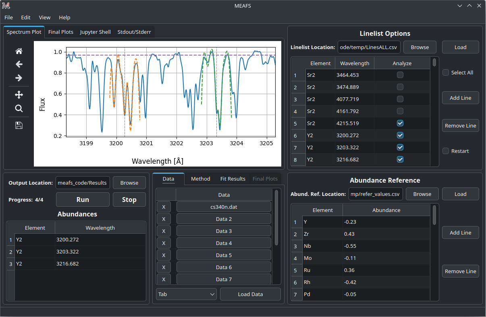

# Summary

The Multiple Element Abundance Fit Software (MEAFS) is an open-source tool mainly developed in `Python 3` with an user-friendly graphical user interface (GUI) in `PyQT6`. One aim of the code is to fit observed spectra to measure chemical abundances using either mathematical functions or synthetic spectra, but also continuum, convolution and wavelength shift for spectral lines. Furthermore, MEAFS can manipulate and prepare the spectrum before running fit functions, e.g. it can combine and normalize multiple spectra.

MEAFS, by itself, does not manipulate any synthetic spectrum in its own code. Hence, at the moment, it uses the `Turbospectrum` code [@plez12] with user inputted stellar atmosphere models for iteratively generate spectra with multiple different parameters during the fit process. The modularity of the code allow future implementations for other sources of synthetic spectra.

Within the software is also possible to fit parameters without usage of synthetic spectra. Profiles like gaussian, Lorentzian and Voigt, and included line parameters (continuum, convolution and wavelength shift) are fitted within seconds for hundreds of lines.

# Statement of need

The measurement of equivalent widths (EWs) and abundances in stars with a precise normalized continuum is a method needed for the derivation of stellar parameters and chemical abundances. Such method requires tools to be measured and the need for them is becoming more crucial given the ongoing and near-future large surveys, making available millions of stellar spectra.

Among the most well-known such tools, DAOSPEC [@stetson08] and BACCHUS [@masseron16] are codes of widespread use. DAOSPEC is a FORTRAN code that measures EWs, given a list of lines as input. These measurements are fundamental for excitation equilibrium methods, which are widely used to derive stellar parameters for cool stars by linking the EWs of `Fe I` and `Fe II` lines spamming a range of excitation potentials to their chemical abundances to derive stellar parameters

BACCHUS (Brussels Automatic Code for Characterizing High accUracy Spectra) derives stellar parameters, equivalent widths, and abundances. As MEAFS, it uses `Turbospectrum` to compute synthetic spectra, with linelist and model atmosphere already incorporated.

The present code was developed inspired by the needs applied to data from the near-future Cassegrain U-Band Efficient Spectrograph (CUBES) [@cristiani22], to be installed at the Very Large Telescope (VLT) of the European Southern Observatory (ESO). CUBES is designed to be a high efficiency spectrograph to be installed at the Cassegrain focus of the VLT,  operating in the range $3000 - 4000 {\rm \AA}$. Although, the present code can be used in any wavelength range given the proper atmosphere models.

# State of the field

Stellar abundance analysis is an ongoing interest field of research for many different astronomic purposes, with many spectra being taken every night throughout different spectrographs in the world. The big data era has already started: current spectrographs produce gigabytes of data for each night, upcoming ones will generate even more.

Per line precise analysis require many iterations with synthetic spectrum generation software, which is a tedious process that requires many hours of work. On top of that, manually fitting lines does not provide any statistical analysis, but MEAFS, using mathematical data analysis, can provide a trace back to errors with statistical methods and confidence intervals.

Available software either do not do abundance itself, but equivalent width only; or, when analyzing the abundance, their own stellar atmosphere models are used. Another path to follow is to use neural networks as the code `The Payne` [@ting19] uses to find the best fit parameters. Given good hardware resources and sufficient spectra to train a model that will reflect the needs of the research, results can be very accurate.

MEAFS uses a different approach: while requiring another tool to be installed, it gives the freedom of choice for the user to have the most appropriate models for its use case. Aligned with its modern programming language and easy setup, MEAFS provides a mathematical tool for quick discovering element abundances in stars that can help research groups.

# Software design

MEAFS is published as a Python package, therefore it has an easy installation process through `pip`. An user-friendly GUI is implemented using `PyQT6` and the software provides fast and multiple line calculations, easy-to-ready text output and ready-to-publish plots. Figure \ref{fig:gui} shows the initial GUI with an analyzed spectrum.

The fit analyses can use either `Turbospcetrum` or mathematical profiles such as gaussians, Lorentzians or Voigt[^1]. The first fit iteration will start with an user input guess or, if no input was defined, with an internal predefined value. The applied method calculates the $\chi^2$ between the observed and the synthetic spectrum (or mathematical curve) and uses the Nelder-Mead [@amoeba] from the `SciPy` [@scipynelder] package to minimize multiple values at once. More precisely, it firstly try to minimize the continuum, convolution and wavelength shift; then it minimizes only the abundance/depth of the line; lastly it repeats the whole process once more with now the found parameters as the first guess of the iteration.

[^1]: If only mathematical profiles are used, `Turbospectrum` does not need to be installed.

The applied $\chi^2$ function is defined as:

$$\chi^2 = \sum_{n=0}^{N} \frac{(F_{n,obs}-F_{n,synth})^2}{F_{n,synth}}$$

Where $F_{n,obs}$ is the flux data point in the observed spectrum, the $F_{n,synth}$ is the flux data point in the synthetic spectrum and $N$ is the length of the current array. Each line fit is done independently by truncating the spectrum in a small region around the line (the window size is also defined by the user or using a predefined value).

To speed-up the $\chi^2$ mathematical operations, this part of the code is written using the C Language. The integration between Python and C is done via the Ctypes package. 

## Analyzing the results

Within MEAFS, it is possible to see the output for the overrall spectrum and for individual lines in a table and in a plot. In case some lines are not well fitted, it is possible to modify them to generate a final CSV table to be exported and also to create final plots as shown in Figure \ref{fig:plot}.

Among the available plot types, box plots can also be generated, as illustrated in Figure \ref{fig:boxplot}, providing a concise statistical summary of each element, including the median, quartiles, dispersion, and potential outliers.

# Research impact statement

MEAFS offers a modern and quick way to get the important information in the field of stellar abundances analysis, specially in the era of big data for high precision spectrographs and giant telescopes.

MEAFS has been successfully used for UVES [@ernandes23; @nunes26] and GIRAFFE spectra (high and low resolution spectra). High precision analyses of $\approx 200$ lines, using `Turbospectrum`, are carried out in around 2 hours. While, the same dataset using just mathematical models are ready within a minute. 

The software is being actively used in the research group. While as an open source published software with a detailed documentation[^2] other groups can make use of its features and request improvements on the code.

[^2]: MEAFS documentation is available at [MEAFS RTD docs](https://meafs.readthedocs.io/).

# AI usage disclosure

The core functions of MEAFS were developed before widespread availability of generative AI. In later development, ChatGPT was used for only questions about which and how to use some packages or functions. None of the logic or math applied in the code had generative AI help.

For this manuscript, ChatGPT was used in some parts for reviewing proper english writing, without changing the author's vocabulary or intended meaning.

All generative AI usage was carefully reviewed throughout all the steps.

# Acknowledgements

The authors acknowledge the Brazilian National Council for Scientific and Technological Development (CNPq) for funding the Master's program during which this code was primarily developed (process number 131689/2022-3).

# References